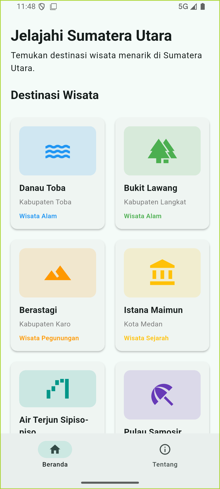
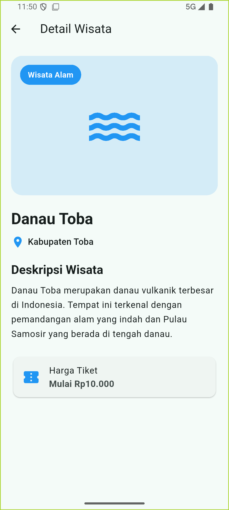
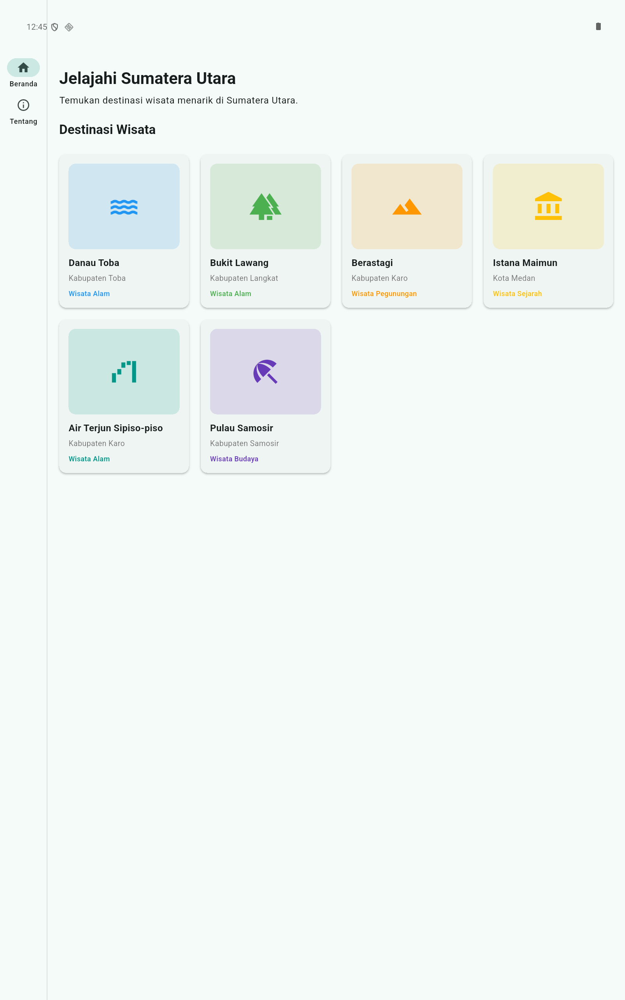
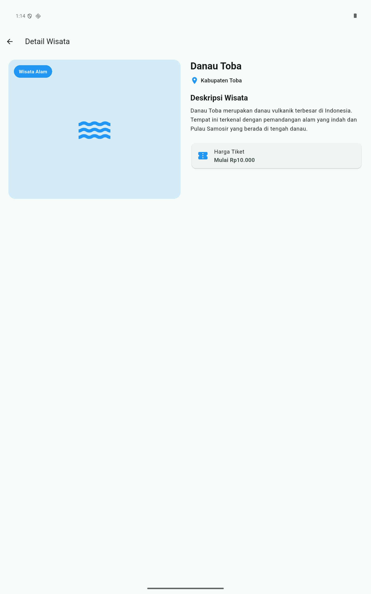

# Wisata Sumatera Utara

Aplikasi Flutter untuk menampilkan informasi destinasi wisata di Sumatera Utara dengan tampilan responsif dan navigasi multi-screen.

## Identitas

- **Nama:** Tegas Ramadhan
- **NIM:** 4243250043
- **Kelas:** PSIK24D
- **Mata Kuliah:** Pemrograman Mobile

## Fitur Aplikasi

- Menampilkan 6 destinasi wisata Sumatera Utara.
- Menampilkan informasi detail setiap destinasi.
- Navigasi menggunakan NavigationBar dan NavigationRail.
- Tampilan responsif untuk berbagai ukuran layar.
- Penanganan halaman destinasi yang tidak ditemukan.

## Screenshot

### Tampilan HP

### Tampilan Tablet

## Penerapan Responsivitas

Aplikasi ini menggunakan pendekatan desain responsif agar tampilannya dapat menyesuaikan berbagai ukuran layar. Pada halaman beranda, LayoutBuilder digunakan untuk menentukan jumlah kolom berdasarkan lebar layar. Perangkat dengan lebar di bawah 600 dp menggunakan dua kolom, lebar 600–899 dp menggunakan tiga kolom, sedangkan layar dengan lebar 900 dp atau lebih menggunakan empat kolom. Dengan demikian, kartu destinasi dapat ditampilkan secara proporsional.

Pada halaman detail, LayoutBuilder digunakan untuk mengatur susunan konten. Layar sempit menampilkan gambar dan informasi secara vertikal, sedangkan layar lebar menampilkan keduanya berdampingan. Stack digunakan untuk menyusun elemen visual pada halaman detail.

Navigasi juga menyesuaikan ukuran layar. NavigationBar digunakan pada layar dengan lebar di bawah 840 dp, sementara NavigationRail digunakan pada layar yang lebih lebar. Pengaturan ini membuat navigasi tetap mudah digunakan. Selain itu, penggunaan widget fleksibel membantu mengurangi risiko overflow ketika aplikasi dijalankan pada ukuran layar berbeda.

## Teknologi

- Flutter
- Dart
- go_router

## Penggunaan AI

ChatGPT digunakan sebagai alat bantu dalam memahami materi, menyusun struktur aplikasi, memperbaiki kode, dan membantu proses pengujian. Seluruh hasil implementasi diperiksa dan dijalankan kembali oleh pengembang.
